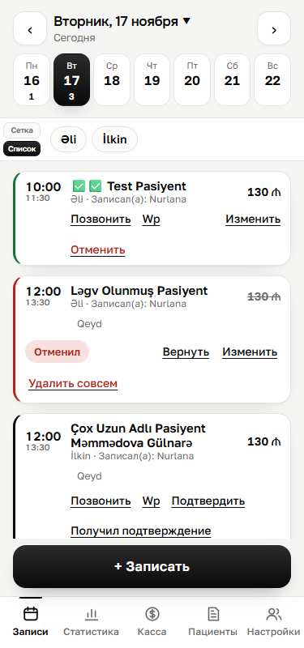
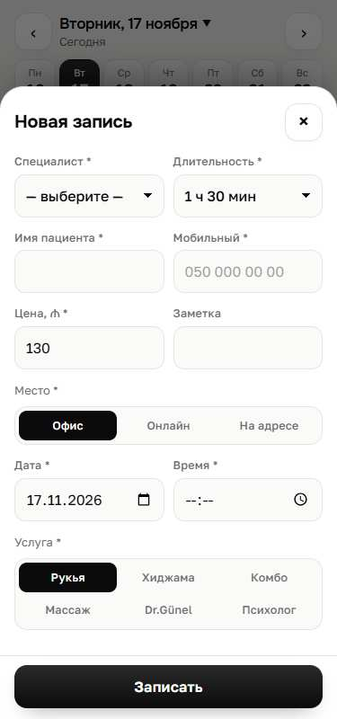
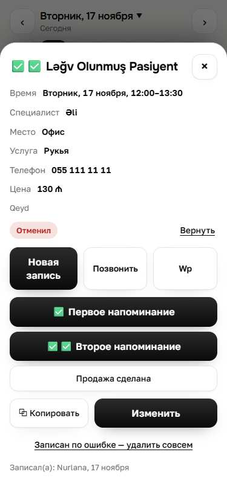
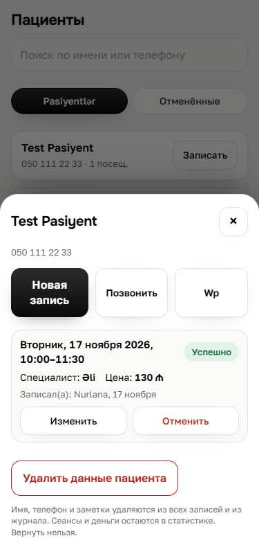

# USER_GUIDE — руководство пользователя «Mərkəz»

Приложение записи пациентов центра. Работает в браузере телефона или компьютера и как приложение Android. Язык меняется в настройках (азербайджанский / русский). Снимки ниже — русский интерфейс, экран 375 px.

## Вход и выход
Вход — по адресу почты и паролю, который выдаёт администратор (самостоятельной регистрации нет). Если приложением не пользуются 7 дней, оно само выходит из учётной записи; виджет на главном экране Android в это же время скрывает имена пациентов.

## Календарь дня

- Колонки — специалисты (имена внизу, под колонками), блоки — записи (цвет специалиста): ✅ и имя пациента, ниже номер и кто записал — сколько помещается в блок. Размер блоков — Ayarlar → Görünüş (по умолчанию «Kiçik»; «Bütün gün» — весь день 09:00–22:00 на одном экране).
- Чёрные блоки — отменённые записи («Ləğv olunanlar»); время отменённой записи можно занять заново.
- Стрелки и строка дней сверху — переход по дням; переключатель «список» показывает тот же день списком:

## Новая запись
Нажмите «+ Yaz» или пустое место в колонке специалиста (специалист выберется сам, длительность по умолчанию 1 ч 30 мин).

Обязательны: специалист, длительность, имя, телефон (любой текст), цена, место (Офис / Онлайн / На адресе), дата, время и услуга (последнее поле: Ruqya по умолчанию, Hicama, Kombo, Masaj, Dr.Günel, Psixoloq). Если время занято, внизу появится красное сообщение. Если закрыть окно, не сохранив, введённое сохраняется черновиком — «Geri aç» возвращает его.

## Перерыв (как в Google Calendar)
В окне новой записи наверху переключатель «Qəbul | Fasilə». «Fasilə» берёт день, время и специалиста из окна; по умолчанию перерыв на **один день**. «Bütün gün» — весь день (выходной). «Təkrar» — каждый день, каждую неделю, по будням, каждый месяц или свои дни недели; «Son tarix» — до какого дня (пусто — всегда). Нажмите на перерыв в календаре или в списке, чтобы открыть его: «Dəyiş» или «Sil»; у повторяющегося спросят — только этот день, этот и следующие или все дни. В Ayarlar → Fasilələr видны действующие перерывы.

Пустое поле времени открывает часы на целом часе (19:00). Под датой и временем — «Ən yaxın boş vaxtlar»: ближайшие свободные окна, нажатие подставит специалиста, дату и время.

## Карточка записи

«Позвонить», «Wp» (WhatsApp; в приложении Android открывается WhatsApp Business, если он установлен), «Подтвердить» (сообщение пациенту) и «Получил подтверждение», «Копировать», «Изменить», «Отменить (не пришёл)» и «Записан по ошибке — удалить совсем». Когда сеанс закончится, запись сама станет успешной. Отменённую запись видно в разделе «Отменённые»; у неё есть кнопки «Новая запись», «Звонок», «Wp» и отметки напоминаний (✅ первое, ✅✅ второе, ✅✅✅ «Satış edildi» — продажа). После «Satış edildi» запись снова цветная в календаре, считается успешной в статистике и уходит из «Отменённых»; повторное нажатие возвращает её в отменённые:

## Пациенты

Поиск по имени (буквы) или по телефону (только цифры). Кнопка «Hamısını telefon kontaktlarına əlavə et» добавляет всех пациентов (имя и номер) в контакты телефона; в карточке пациента — «Telefon kontaktlarına əlavə et» для одного. На Android приложение добавляет само (один раз спросит разрешение), на iPhone откроется файл контактов — нажмите «Добавить все контакты». Карточка пациента — все визиты за два года:

## Статистика и касса
Разделы: «Bu gün» (только сегодняшний день, в Excel не выгружается), «Bu həftə», «Keçən həftə», «Bu ay», «Keçən ay»; у админа ещё «Pul», у админа и агентов «Məhsul» (там свои кнопки периода). В каждом периоде:
- **Ümumi cədvəl** — одна таблица: обращения WP/SŞ, Yazdı / Uğurlu / Ləğv, услуги и место по каждому, кто записывал (названия столбцов написаны снизу вверх; таблицу можно листать вбок). Числа обращений, «Yazdı» и «Uğurlu» можно исправить нажатием.
- **Qaydalar və terminlər** — правила подсчёта (нажмите, чтобы раскрыть).
Кнопка Excel выгружает выбранный период.

**Касса.** «+ Məhsul satışı» — товары кнопками (название и цена): нажатие = +1 шт., «−» убирает одну, внизу итог; «Yadda saxla» записывает продажу. Продажу можно изменить (количество) или удалить. Админ ведёт список товаров кнопкой «⚙ Məhsullar»; там же у каждого товара «Satanın faizi» — процент для каждого специалиста и агента. Эта доля видна в статистике «Məhsul» в столбце «Payı»: админ видит всех, специалист и агент — только себя. Специалист видит в Кассе только свои продажи (расходов у него нет), агенты и админы — все.

## Пациенты: «Təsdiq» и «Qayıtmayanlar»
«Təsdiq» — записи на сегодня и завтра, ещё не подтверждённые (число на кнопке): «Təsdiq» открывает готовое сообщение в WhatsApp, после ответа нажмите «Təsdiq aldı». «Qayıtmayanlar» — пациенты, которые были 14–90 дней назад и больше не записаны: звонок, приглашение в WhatsApp, «Yeni qəbul yaz».

## Настройки (администратор)
Специалисты (цвет, архив), перерывы (каждый день, по дням недели или на даты; специалист может ставить перерывы своей колонке), сотрудники и роли (админ меняет имена, в том числе своё, и может отметить агента «Не показывать в статистике»), вид, учётная запись.

 

«Журнал изменений» — кто что изменил или удалил; удалённую запись можно вернуть кнопкой «Bərpa et»:

## Если что-то не так
- «Нет интернета» — приложение покажет сохранённые данные и само обновится, когда связь вернётся.
- Сообщение о выходе после 7 дней без использования — войдите снова.
- Запись не сохраняется — прочитайте красное сообщение под формой (занято время, не заполнено поле); введённое не теряется.
