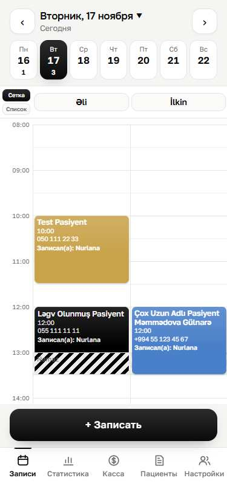
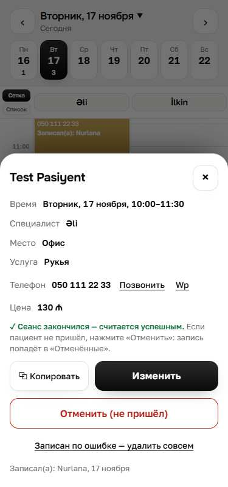
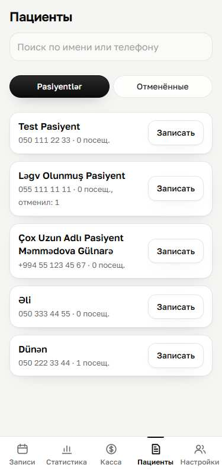
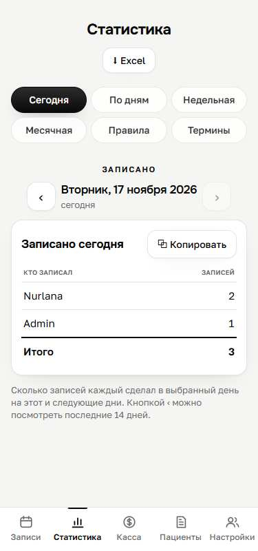
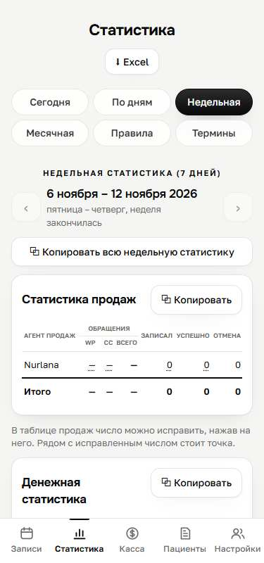
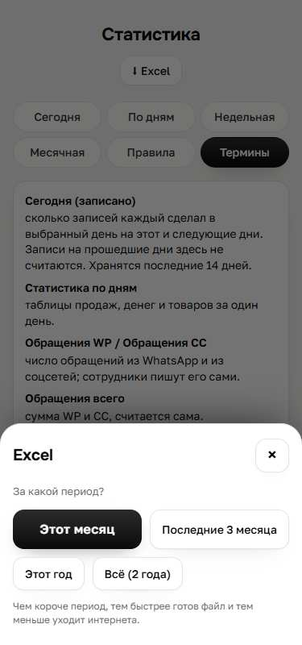
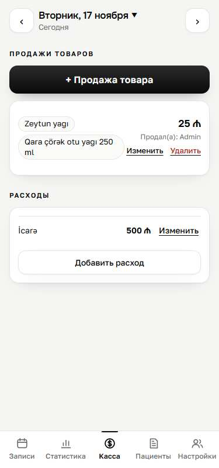
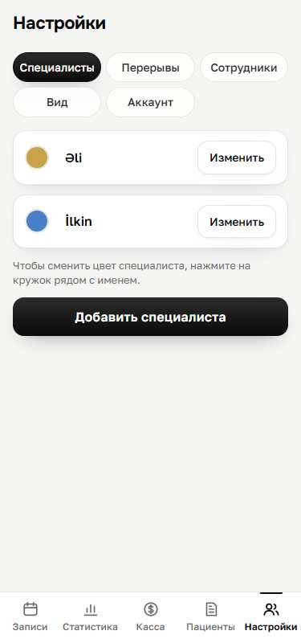
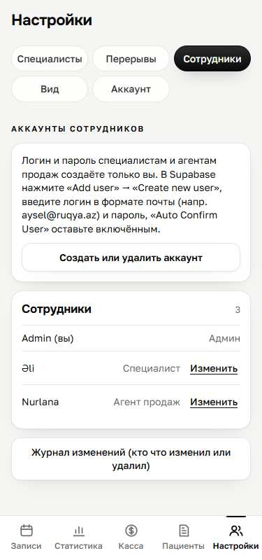
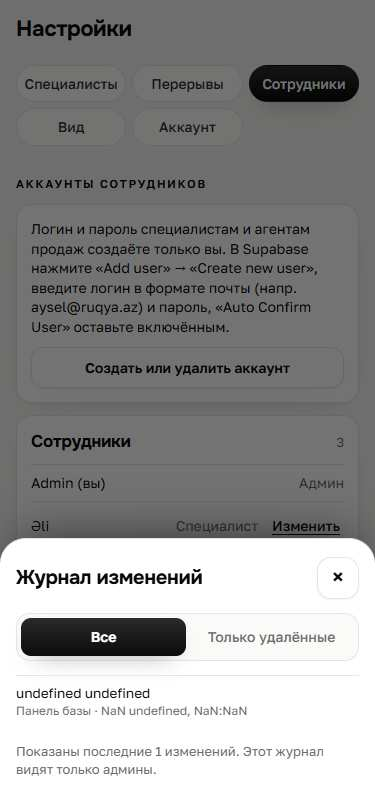

# USER_GUIDE — руководство пользователя «Mərkəz»

Приложение записи пациентов центра. Работает в браузере телефона или компьютера и как приложение Android. Язык меняется в настройках (азербайджанский / русский). Снимки ниже — русский интерфейс, экран 375 px.

## Вход и выход
Вход — по адресу почты и паролю, который выдаёт администратор (самостоятельной регистрации нет). Если приложением не пользуются 7 дней, оно само выходит из учётной записи; виджет на главном экране Android в это же время скрывает имена пациентов.

## Календарь дня

- Колонки — специалисты (имена внизу, под колонками), блоки — записи (цвет специалиста): ✅ и имя пациента, ниже номер и кто записал — сколько помещается в блок. Размер блоков — Ayarlar → Görünüş (по умолчанию «Kiçik»; «Bütün gün» — весь день 09:00–22:00 на одном экране).
- Чёрные блоки — отменённые записи («Ləğv olunanlar»); время отменённой записи можно занять заново.
- Стрелки и строка дней сверху — переход по дням; переключатель «список» показывает тот же день списком:

## Новая запись
Нажмите «+ Yaz» или пустое место в колонке специалиста (специалист выберется сам, длительность по умолчанию 1 ч 30 мин).

Обязательны: специалист, длительность, имя, телефон (любой текст), цена, место (Офис / Онлайн / На адресе), дата, время и услуга (последнее поле: Ruqya по умолчанию, Hicama, Kombo, Masaj, Dr.Günel, Psixoloq). Если время занято, внизу появится красное сообщение. Если закрыть окно, не сохранив, введённое сохраняется черновиком — «Geri aç» возвращает его.

## Карточка записи

«Позвонить», «Wp» (WhatsApp; в приложении Android открывается WhatsApp Business, если он установлен), «Подтвердить» (сообщение пациенту) и «Получил подтверждение», «Копировать», «Изменить», «Отменить (не пришёл)» и «Записан по ошибке — удалить совсем». Когда сеанс закончится, запись сама станет успешной. Отменённую запись видно в разделе «Отменённые»; у неё есть кнопки «Новая запись», «Звонок», «Wp» и отметки напоминаний (✅ первое, ✅✅ второе, ✅✅✅ «Satış edildi» — продажа). После «Satış edildi» запись снова цветная в календаре, считается успешной в статистике и уходит из «Отменённых»; повторное нажатие возвращает её в отменённые:

## Пациенты

Поиск по имени (буквы) или по телефону (только цифры). Кнопка «Hamısını telefon kontaktlarına əlavə et» добавляет всех пациентов (имя и номер) в контакты телефона; в карточке пациента — «Telefon kontaktlarına əlavə et» для одного. На Android приложение добавляет само (один раз спросит разрешение), на iPhone откроется файл контактов — нажмите «Добавить все контакты». Карточка пациента — все визиты за два года:

## Статистика и касса
 

Разделы «Сегодня / По дням / Недельная / Месячная» (в последних трёх — таблица «Услуги»: сеансы и успешные по каждой услуге), «Правила» (как считаются цифры) и «Термины». В «По дням / Недельная / Месячная» есть также таблицы «По месту» (офис / онлайн / по адресу) и «Услуги по агентам». Кнопка Excel выгружает выбранный период — со всеми этими таблицами:

Касса — расходы и продажи товаров:

## Настройки (администратор)
Специалисты (цвет, архив), перерывы (каждый день, по дням недели или на даты; специалист может ставить перерывы своей колонке), сотрудники и роли (админ меняет имена, в том числе своё, и может отметить агента «Не показывать в статистике»), вид, учётная запись.

 

«Журнал изменений» — кто что изменил или удалил; удалённую запись можно вернуть кнопкой «Bərpa et»:

## Если что-то не так
- «Нет интернета» — приложение покажет сохранённые данные и само обновится, когда связь вернётся.
- Сообщение о выходе после 7 дней без использования — войдите снова.
- Запись не сохраняется — прочитайте красное сообщение под формой (занято время, не заполнено поле); введённое не теряется.
